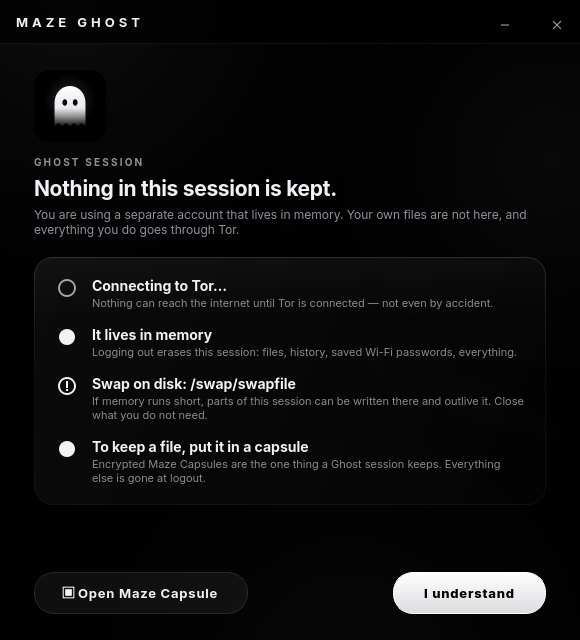

<div align="center">


# Maze Ghost

**A login that keeps nothing and only speaks Tor.**

*For Maze Linux*

</div>

---

Choose **Ghost** at the login screen and you get a full Plasma desktop that:

- **lives in memory** — its home folder is created empty in RAM at every login and erased at logout, together with everything the session left elsewhere;
- **reaches the internet only through Tor** — every connection of the Ghost account is forced through a Tor of its own by the firewall; if Tor is not connected, nothing goes out at all;
- **is a different person** — a separate account with no access to your files, your keys or your browser profiles, and (with Maze Cloak) a new MAC address.

It is the closest thing to booting Tails without rebooting.



## What happens

**At login** (as root, before the desktop starts — a drop-in for the Ghost account's own user manager, so no other account's login is involved):

1. The Tor-only firewall is checked. If it is not loaded, the login is refused.
2. A fresh tmpfs is mounted on `/home/ghost` and filled from `/etc/skel` (Maze's desktop defaults).
3. The Ghost Tor (`maze-ghost-tor.service`) is started, and Maze Cloak, if running, is asked for a new MAC address.

**While it runs**, the firewall (`maze-ghost-firewall.service`, loaded at boot) applies to the `ghost` uid only:

| | |
|---|---|
| TCP | redirected to the Ghost Tor's TransPort — every program, whether it knows about proxies or not |
| DNS | to any server, redirected to the Ghost Tor's DNSPort; `.onion` names work everywhere |
| UDP, ICMP, IPv6 | dropped |
| Local services | closed — a Ghost program cannot reach CUPS, a local proxy that would go out directly, or another user's server; only the Tor ports |

Other accounts are not affected: their packets leave the chain at its first rule. If the firewall service is ever stopped, the Ghost session is ended first.

**At logout** (and once at boot, for a session that never got to end — a crash, a power cut):

- every Ghost process is killed (`KillOnlyUsers=ghost`), unlocked capsules are unmounted;
- the home tmpfs is unmounted — that is its deletion;
- Ghost files in `/tmp`, `/var/tmp` and `/dev/shm`, Ghost crash dumps, and the Ghost user's own journal files are deleted;
- Wi-Fi networks saved in the session (with their passwords) are forgotten;
- the Ghost Tor is stopped.

A crash never writes a core dump (`hard core 0`), and the Ghost account cannot hibernate (polkit), because hibernation writes all of memory to disk.

## Keeping files

Nothing survives a Ghost session — except what you put in an **encrypted Maze Capsule**. Capsules created in a Ghost session are stored in `/var/lib/maze-ghost/persistent` (gocryptfs, encrypted with your password) and are there again at the next Ghost login. Everything else is gone.

## What it cannot do

- **Swap on disk.** If memory runs short, the kernel may write parts of the session to a disk swap area, where they outlive it. Maze uses zram (in memory) by default; with a swap file or partition the welcome window says so.
- **The system journal** records that a Ghost session took place (login and logout), not what was done in it.
- **It is not a different computer.** The kernel, the hardware and the rest of the system are shared with the other accounts. An attacker with root on this machine, or with physical access while the session runs, can see it.
- **Tor hides where you are, not who you are.** Logging in to an account identifies you, through Tor or not.
- **A Tor Browser downloaded inside the session** starts its own Tor, which then runs through the Ghost Tor: it works, slower. The Ghost session already sends everything through Tor.

## Networks that block Tor

Put bridge lines in a file under `/etc/maze-ghost/torrc.d/` (any name not starting with a dot), for example:

```
UseBridges 1
ClientTransportPlugin obfs4 exec /usr/bin/obfs4proxy
Bridge obfs4 192.0.2.1:443 FINGERPRINT cert=... iat-mode=0
```

then `sudo systemctl restart maze-ghost-tor` (or log in again).

## Install

```bash
sudo pacman -S maze-ghost
```

Restart once afterwards: logind reads its new settings at boot. The account appears at the login screen as **Ghost**, without a password; sshd refuses empty passwords, so it cannot be used remotely.

Removing the package removes the account. Capsules in `/var/lib/maze-ghost/persistent` are kept; delete that folder by hand when you no longer need them.

## Tests

```bash
/opt/maze/venv/bin/python3 -m unittest discover -s tests -v
```

The firewall is tested for real — its rules are loaded into an unprivileged network namespace, once as the Ghost uid and once as another, and what gets through is checked. The session scripts are checked to do nothing, and succeed, for any other uid.

## License

Copyright © 2026 Berk Küçük — GPL3, see [LICENSE](LICENSE).
